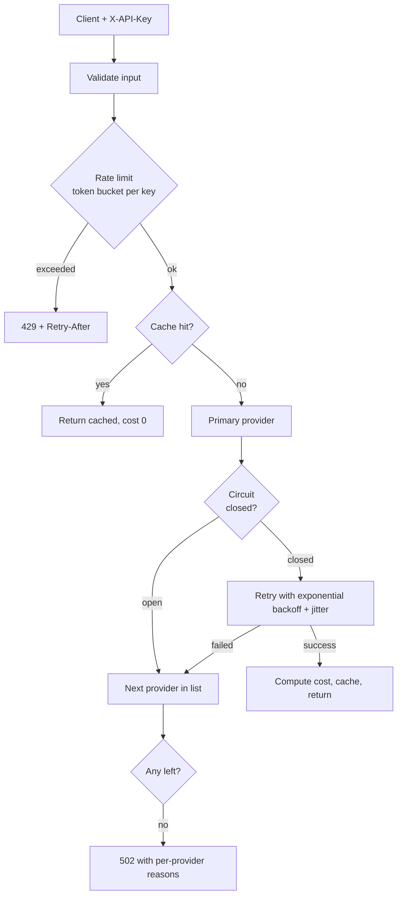

# LLM Gateway

> A resilient layer between your application and LLM providers: **caching, per-client rate limiting, retries with backoff, circuit breaking, provider fallback and cost tracking.**

Calling an LLM API directly from application code works in a demo and fails in production: providers rate-limit, time out and go down, costs creep up, and one noisy client can starve the rest. This gateway centralises those concerns behind one endpoint, and every behaviour is covered by deterministic tests (no network, no sleeping).

## Request flow



## Features

| Capability | Implementation | Why it matters |
|---|---|---|
| Response cache | LRU + TTL, keyed by SHA-256 of `(prompt, max_tokens)` | Repeated prompts cost nothing; `saved_usd_by_cache` is reported |
| Rate limiting | Token bucket per API key, `Retry-After` on 429 | Fair sharing; protects your upstream quota |
| Retries | Exponential backoff with jitter, **only for retryable errors** | Survives transient failures without retry storms; 4xx errors fail fast |
| Circuit breaker | closed -> open -> half-open probe | Stops wasting latency on a provider that is down |
| Fallback | Ordered provider list | A provider outage becomes a slower response, not an incident |
| Cost tracking | Tokens x configurable price table; unknown models are flagged, not guessed | Visibility per request and in aggregate |
| Metrics | `/metrics`: counters, hit rate, cost, p50/p95 latency, breaker states | Observability from day one |

## Quick start

```bash
# Offline demo of retries, fallback and caching
PYTHONPATH=src python scripts/demo.py

# Tests (19)
PYTHONPATH=src python -m unittest discover -s tests -v

# Run the service
pip install -e ".[api,anthropic]"
export PROVIDERS=anthropic,mock          # ordered: first is primary
export ANTHROPIC_API_KEY=...
uvicorn gateway.app:app --reload

curl -X POST localhost:8000/v1/complete \
  -H 'X-API-Key: team-a' -H 'content-type: application/json' \
  -d '{"prompt": "Explain circuit breakers in one sentence", "max_tokens": 100}'

curl localhost:8000/metrics
```

Docker: `docker build -t llm-gateway . && docker run -p 8000:8000 -e PROVIDERS=mock llm-gateway`

Demo output:

```
1) transient failures are retried
   provider=primary attempts=3
2) a dead provider triggers fallback
   provider=backup cost=$0.00003500
3) identical request is served from cache at zero cost
   cached=True cost=$0.0
```

## Design decisions

- **Injectable clock and sleep.** Time-dependent logic (TTL, bucket refill, backoff, breaker cooldown) takes a clock, so tests are instant and deterministic instead of flaky `sleep()` calls.
- **Gateway owns retry policy.** The Anthropic SDK is created with `max_retries=0`, so retries are not multiplied across layers and are visible in metrics.
- **Retryable vs non-retryable.** Upstream 429/5xx/connection errors are retried; other 4xx errors (bad request, invalid key) are not, and go straight to fallback.
- **Cached entries remember their original cost**, which is how savings are computed honestly.
- **Pure core, thin HTTP layer.** `gateway/gateway.py` has no web-framework dependency; `app.py` only maps exceptions to HTTP status codes.

## Limitations and next steps

- State (cache, buckets, breakers) is **in-process**. For multiple replicas move it to Redis (shared cache, distributed token bucket).
- No single-flight: concurrent identical cache misses each call the provider. Add request coalescing.
- Caching is exact-match only and assumes deterministic-enough outputs; semantic caching needs embeddings and a similarity threshold.
- Prices in `pricing.py` are placeholders; configure them from your provider's price list.
- No streaming support yet, and API keys are not authenticated (they only identify clients for rate limiting). Add real auth before exposing it.
- Add Prometheus/OpenTelemetry export in place of the JSON `/metrics`.

## Layout

```
src/gateway/  cache, ratelimit, retry, breaker, providers, pricing, metrics, gateway (core), app (FastAPI)
tests/        19 tests        scripts/demo.py   offline resilience demo
```
