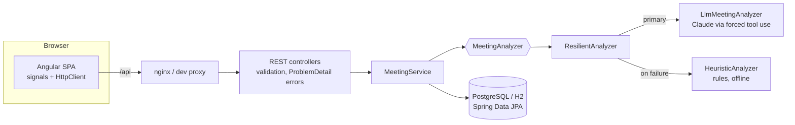

# Meeting Actions Tracker (Java + Spring Boot + Angular)

> Paste meeting notes, get a summary, the decisions taken and a **tracked list of action items** with owner, due date and priority. Extraction uses an LLM (Claude) when configured, and falls back to a built-in rule engine when it is not available.

A full-stack, enterprise-style application: **Java 21 / Spring Boot REST API + JPA** and an **Angular 19 (standalone components, signals)** single-page app, with PostgreSQL, Docker Compose and CI. The AI part is deliberately small and well-contained, so most of the project shows classic back-end/front-end engineering.

## Features

- Analyze notes into **summary, decisions and action items** (owner, due date, priority).
- Relative dates are resolved against the meeting date ("by Friday" becomes a real date).
- Track items through a workflow: `OPEN -> IN_PROGRESS -> DONE / CANCELLED`, with reopen. Illegal moves return `409`.
- Filter by status and owner, overdue highlighting, per-status counters.
- **Works with no API key**: the rule-based analyzer understands `Decision:`, `Action:`, `TODO:`, `- [ ]`, `@owner`, ISO dates, weekdays and English/Portuguese prefixes.
- Each meeting records **how it was analyzed** (`llm` or `heuristic`) and the UI shows it.

## Architecture



**Backend packages**

| Package | Responsibility | Framework dependency |
|---|---|---|
| `domain` | `ItemStatus` workflow rules, `Priority`, `Analysis`, `ActionItemDraft` | none (plain Java) |
| `analysis` | analyzers, output validation (`AnalysisMapper`), input sanitising, prompt building | none (plain Java) |
| `llm` | `AnthropicStructuredLlm`: HTTP call to the Messages API | Spring `RestClient` |
| `persistence` | JPA entities and repositories | Spring Data JPA |
| `service` | use cases, transactions, DTO mapping | Spring |
| `web` | controllers, DTOs, error mapping | Spring MVC |

## REST API

| Method | Path | Description |
|---|---|---|
| `POST` | `/api/meetings` | Analyze notes and store the meeting (`201`) |
| `GET` | `/api/meetings` | List meetings with open/total item counts |
| `GET` | `/api/meetings/{id}` | Meeting with decisions and action items |
| `DELETE` | `/api/meetings/{id}` | Delete (`204`) |
| `PATCH` | `/api/action-items/{id}/status` | Change an item's status (`409` if the transition is not allowed) |
| `GET` | `/actuator/health` | Health check |

Errors use RFC 9457 `application/problem+json` (`400` validation, `404`, `409`).

```bash
curl -X POST localhost:8080/api/meetings -H 'content-type: application/json' -d '{
  "title": "Weekly sync",
  "meetingDate": "2026-11-02",
  "notes": "Decision: ship the beta\nAction: Ana to send the report by Friday"
}'
```

## Running it

**Everything with Docker** (PostgreSQL + API + UI on http://localhost:4200):

```bash
docker compose up --build
# with Claude:
ANTHROPIC_API_KEY=... LLM_PROVIDER=anthropic docker compose up --build
```

**Locally for development:**

```bash
# terminal 1: API on :8080 (file-based H2, rule-based analyzer, no key needed)
cd backend && mvn spring-boot:run

# terminal 2: UI on :4200, proxying /api to :8080
cd frontend && npm install && npm start
```

Configuration (environment variables): `LLM_PROVIDER` (`heuristic` | `anthropic`), `ANTHROPIC_API_KEY`, `ANTHROPIC_MODEL`, `DB_URL`, `DB_USER`, `DB_PASSWORD`, `CORS_ORIGINS`.

Tests: `cd backend && mvn verify` and `cd frontend && npm test`.

## Design decisions worth discussing

- **The model never returns free text I have to parse.** The API call forces a tool (`tool_choice`), so the model answers with a JSON object that follows a schema. No markdown-fence stripping, no regex over prose.
- **Model output is still untrusted.** `AnalysisMapper` defaults unknown priorities, drops malformed dates (an invented date is worse than none), discards items without a description, treats owners such as "none" or "n/a" as unassigned, and caps the number of items.
- **Prompt-injection hygiene.** Notes are wrapped in a delimiter, any delimiter inside the notes is removed, and the system prompt says the notes are data. The model only produces data; it triggers no actions, so the blast radius is a wrong summary.
- **Graceful degradation.** `ResilientAnalyzer` falls back to the rule engine on `LlmException` only. Programming errors are not swallowed (tested).
- **No database connection held during the LLM call.** `MeetingService.create` is intentionally not `@Transactional`; only the final save is.
- **Workflow rules live in one place.** `ItemStatus` defines allowed transitions; the API returns `allowedStatuses` per item, so the Angular app renders buttons without duplicating the rules.
- **`open-in-view: false`** and DTO mapping inside service transactions avoid accidental lazy loading in the web layer; the list endpoint uses an `@EntityGraph` to avoid an N+1 query.
- **Framework-free core.** Domain and analysis code is plain Java, so it is tested in milliseconds without Spring.
- **API key hygiene.** The key is read from the environment, sent only as a header and excluded from error messages.

## What has been verified, and what has not

Be aware of this before publishing the repository:

| Part | Status |
|---|---|
| `domain` + `analysis` (plain Java, 24 JUnit tests) | Compiled with JDK 21 and **all tests executed and passing** |
| Angular helper logic `util/action-items.ts` (9 specs) | Type-checked in strict mode and **specs executed and passing** |
| Spring layer (`config`, `llm`, `persistence`, `service`, `web`) and `MeetingApiIntegrationTest` | Syntax-checked only. **Not compiled or run**: the authoring environment had no Maven and no network |
| Angular components, `angular.json`, Docker files, `docker-compose.yml`, CI | **Not built or run** for the same reason |

First-run checklist: `cd backend && mvn verify`, then `cd frontend && npm install && npm test && npm run build`, then `docker compose up --build`. Expect to fix small things (a missing import, a version bump). Fixing them is a good way to learn the code.

## Known limitations and next steps

- **Spring Boot version.** The project uses 3.5.x, whose open-source support ended in June 2026. Upgrade to Spring Boot 4 once it builds. The code avoids direct `ObjectMapper` use (Spring Boot 4 moves to Jackson 3) so the main work should be test-starter and package changes; follow the official migration guide.
- No authentication or multi-user ownership. Next: Spring Security with JWT/OIDC, and meetings owned by a user.
- `ddl-auto: update` is for demos; add Flyway migrations.
- Add pagination to `GET /api/meetings`, editing of owners and due dates, and Playwright end-to-end tests.
- Add rate limiting and per-user cost limits on the analyze endpoint before exposing it publicly (see the companion `llm-gateway` project).
- Evaluate extraction quality on a labelled set of notes with the companion `llm-eval-harness`.

## Project layout

```
backend/    Spring Boot (Maven)   src/main/java/com/example/meetingactions/{domain,analysis,llm,config,persistence,service,web}
frontend/   Angular 19            src/app/{api.service.ts, models.ts, util/, pages/}
docker-compose.yml                PostgreSQL + API + nginx-served UI
```

Rename the base package `com.example.meetingactions` to your own before publishing.
