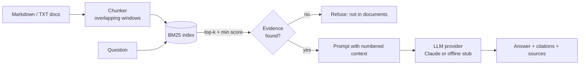

# RAG Document Q&A

> Ask questions about your own documents and get answers **with citations**, or an honest "I don't know" when the documents don't contain the answer.

A compact Retrieval-Augmented Generation (RAG) service built to show production-minded engineering rather than a notebook demo: a from-scratch BM25 retriever, an LLM provider abstraction, a **refusal guardrail**, a REST API, Docker, CI and a retrieval evaluation script.

## Why this project

Companies want LLMs that answer from *their* data and don't hallucinate. The two hard parts are (1) retrieving the right evidence and (2) making the system say "I don't know" when there is none. This project makes both explicit and testable.

## Architecture



| Component | File | Notes |
|---|---|---|
| Chunking | `chunking.py` | Overlapping word windows so facts on a boundary are not lost |
| Retrieval | `retriever.py` | BM25 implemented from scratch, accent-insensitive, EN/PT stopwords |
| LLM layer | `llm.py` | `LLM` protocol; `AnthropicLLM` (Claude) and an offline `ExtractiveLLM` |
| Pipeline | `pipeline.py` | Score threshold guardrail, citation-forcing prompt, grounded flag |
| API / CLI | `api.py`, `cli.py` | FastAPI service and command line |

### Design decisions

- **Refuse before generating.** If no chunk passes `min_score`, the LLM is never called. That prevents hallucination and saves cost (covered by a test).
- **Provider abstraction.** The pipeline depends on a 1-method protocol, so tests and CI run offline with no API key.
- **BM25 first, embeddings later.** BM25 is a strong, cheap baseline and needs no model download. The retriever interface is small enough to swap in a vector store.
- **Measured, not assumed.** `scripts/eval_retrieval.py` reports hit rate@k and MRR on a golden set.

## Quick start

```bash
# 1. Offline demo (no API key needed)
export PYTHONPATH=src
python -m ragqa.cli "What is the daily meal allowance when travelling?"

# 2. With Claude
pip install -e ".[anthropic]"
export ANTHROPIC_API_KEY=...
python -m ragqa.cli "How many days can I work remotely?" --provider anthropic

# 3. As an API
pip install -e ".[api]"
uvicorn ragqa.api:app --reload
curl -X POST localhost:8000/ask -H 'content-type: application/json' \
     -d '{"question": "How long should my password be?"}'
```

Example response:

```json
{
  "answer": "Passwords must have at least 14 characters ... [1]",
  "grounded": true,
  "sources": [{"id": "security_policy.md#0", "source": "security_policy.md", "score": 1.8, "text": "..."}]
}
```

### Docker

```bash
docker build -t ragqa .
docker run -p 8000:8000 -e LLM_PROVIDER=anthropic -e ANTHROPIC_API_KEY=$ANTHROPIC_API_KEY ragqa
```

Use your own documents by mounting a folder and setting `DOCS_DIR`.

## Testing and evaluation

```bash
PYTHONPATH=src python -m unittest discover -s tests -v   # 10 unit tests
PYTHONPATH=src python scripts/eval_retrieval.py          # retrieval quality
```

On the bundled 6-question golden set: **hit rate@3 = 1.00, MRR = 1.00**. The set is deliberately small, so treat it as a regression check, not a benchmark. In an early iteration the score was 0.67: a pure lexical retriever missed "password" vs "passwords", which a light stemmer fixed.

## Known limitations and next steps

- Lexical retrieval cannot match pure synonyms ("lose" vs "lost"). Next: hybrid search (BM25 + embeddings) with reciprocal-rank fusion, then a cross-encoder reranker.
- Chunking is word-based; structure-aware chunking (by heading) would keep sections intact.
- Add PDF/DOCX ingestion and an incremental index.
- Extend evaluation with answer-faithfulness scoring (see the companion `llm-eval-harness` project).

## Project layout

```
src/ragqa/    pipeline code        tests/     unit tests
data/docs/    sample documents     scripts/   retrieval evaluation
```
