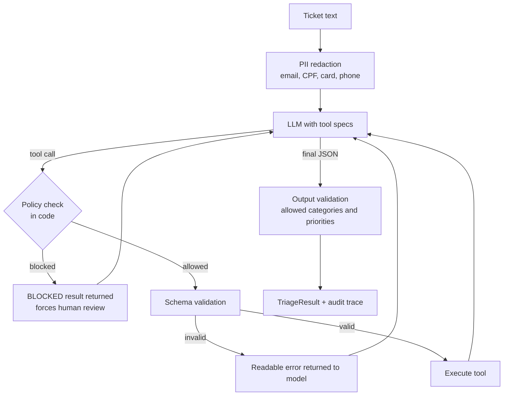

# Support Ticket Triage Agent

> An LLM agent that investigates customer tickets with tools, acts within hard business limits, and hands off to a human when it should.

Agents are easy to demo and hard to trust. This project focuses on the part that makes them shippable: **validation, policy enforcement outside the model, budgets, PII redaction and an audit trail**, all covered by tests that run without an API key.

## What it does

Given a ticket such as *"I want a refund for ORD-1001"*, the agent looks up the order, applies the refund policy, issues the refund if it is allowed, and returns structured JSON:

```json
{
  "status": "resolved",
  "category": "billing",
  "priority": "normal",
  "reply": "Done: refund of 49.90 issued for ORD-1001. It will reach you in 5 business days.",
  "actions": [{"tool": "get_order", "...": "..."}, {"tool": "issue_refund", "...": "..."}],
  "trace": ["every tool call, argument and result, for audit"]
}
```

## Architecture



## Guardrails (the point of this project)

| Risk | Mitigation | Test |
|---|---|---|
| Model approves a refund it should not | `Policy` is enforced in code before the tool runs; blocked actions force `needs_human` **even if the model says otherwise** | `test_policy_overrides_a_model_that_claims_no_human_needed` |
| Malformed or hallucinated tool calls | JSON-schema validation; unknown tools and bad arguments return an error the model can recover from | `test_unknown_tool_does_not_crash_the_run` |
| Infinite loops / runaway cost | `max_steps` and `max_tool_calls` budgets | `test_infinite_loop_is_stopped`, `test_tool_call_budget` |
| Sensitive data sent to a third-party model | Regex redaction before the first model call | `test_pii_never_reaches_the_model` |
| Garbage final answer | Output must parse and use allowed enums, otherwise hand off to a human | `test_invalid_final_answer_goes_to_human` |
| Prompt injection inside the ticket | Ticket treated as untrusted data; the model can only act through whitelisted tools, and money-moving actions are policy-gated regardless of what the model is told | policy tests above |
| Tool bugs | Exceptions are caught and reported to the model as errors | runner behaviour |

## Quick start

```bash
export PYTHONPATH=src

# Offline demo (deterministic rule-based stand-in for the model)
python -m triage.cli "Please refund ORD-1001, the headphones broke"   # auto-resolved
python -m triage.cli "I want a refund for ORD-1002"                  # blocked: 240 > 100 limit -> human
python -m triage.cli "refund ORD-1003"                                # blocked by tool: outside 30-day window

# With a real model using native tool use
pip install -e ".[anthropic]"
export ANTHROPIC_API_KEY=...
python -m triage.cli "Where is my order ORD-1004?" --provider anthropic

# Tests
python -m unittest discover -s tests -v
```

## Design decisions

- **Policy lives in code, not in the prompt.** Prompts are suggestions; code is a guarantee. The system prompt asks the model to respect limits, but the `Policy` class is what actually prevents money from moving.
- **Errors are information.** Validation and business errors are returned to the model as tool results so it can retry or escalate, which is how tool-using models are meant to be used.
- **Provider-neutral message format.** The agent works with its own `Message`/`ToolCall` types; `AnthropicToolLLM.convert` maps them to the API (including grouping parallel tool results into one message, covered by a test). Supporting another provider means writing one adapter.
- **Deterministic test double.** `PolicyLLM` and `ScriptedLLM` let CI exercise the full loop, including failure paths, for free. `PolicyLLM` is a rule-based stand-in and is **not** meant to represent model quality.
- **Audit trail by default.** Every tool call, its arguments and its result are returned in `trace`.

## Limitations and next steps

- The shop backend is an in-memory fake; replace `Shop` with real API clients (and add idempotency keys on refunds).
- PII redaction is regex-based. For production, add a dedicated PII detector and log scrubbing.
- No evaluation of the *model's* decisions yet. Natural next step: build a labelled ticket set and score category accuracy and escalation precision with the companion `llm-eval-harness` project.
- Add human-in-the-loop approval flow (a queue plus resume-from-trace) instead of only flagging `needs_human`.
- Add streaming, retries on transient API errors and per-ticket cost tracking.

## Layout

```
src/triage/
  agent.py       loop, budgets, output validation
  guardrails.py  PII redaction + business policy
  tools.py       registry + argument validation
  shop.py        fake back-office and tool definitions
  llm.py         Anthropic adapter, scripted and rule-based doubles
tests/           14 tests covering happy path and failure modes
```
